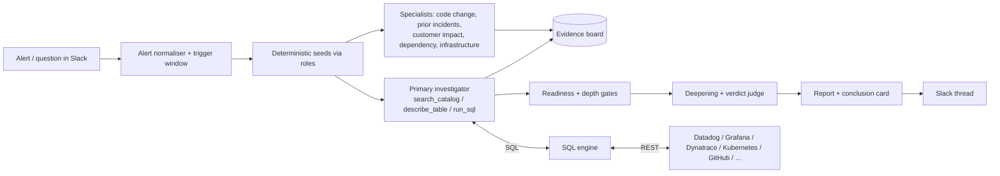

# OmniOps

**A tool-agnostic, Slack-native AI incident investigator.** When an alert lands in Slack (or someone
asks a question), OmniOps investigates with live data from your monitoring stack, whatever it is, and
answers in the thread with a verdict-first card and a cited report.

- **Any platform, one surface.** Datadog, Dynatrace, Grafana (Prometheus, Loki, Tempo, Mimir...), New
  Relic, Splunk, Elastic/OpenSearch, CloudWatch/X-Ray, Azure Monitor, Google Cloud, Honeycomb, Sentry,
  PagerDuty, Opsgenie, Kubernetes, Argo CD, GitHub/GitLab, Jira, Confluence and more: see
  [docs/SOURCES.md](docs/SOURCES.md) for every table and the API endpoint behind it.
- **SQL over REST, no MCP servers.** Each platform's API is declared as virtual SQL tables
  ([docs/MANIFEST_SPEC.md](docs/MANIFEST_SPEC.md)). The model writes SQL; the engine pushes filters into
  API parameters, fetches in parallel, joins and aggregates in DuckDB, and returns compact results with
  digests, links and explicit truncation markers.
- **Slack is the entry point.** Alert channels, @-mentions, DMs and `/investigate`. Writes (dashboards,
  annotations) are staged and need a human to approve them in Slack.
- **Grounded by construction.** Code measures, the model judges: one time anchor per run, evidence IDs
  on every claim, links only from data, competing hypotheses with causal levels, positive controls for
  empty results, a separate verdict judge, calibrated wording, and an "insufficient data" answer below
  the evidence floor. These are the lessons of a year running an earlier Datadog-only system in production
  (see [ARCHITECTURE.md](ARCHITECTURE.md)).
- **LLMs:** Meta Model API (Muse) by default - `muse-wonder-1.0` for evidence, hypothesis, verdict and
  report roles, `muse-spark-1.3` for specialists and formatting - behind a provider-neutral interface
  (any OpenAI-compatible endpoint works via `OMNIOPS_LLM_PROTOCOL=chat`).



## Quick start

Requirements: Python 3.12+ and [uv](https://docs.astral.sh/uv/).

```bash
uv sync
cp .env.example .env        # then fill in MODEL_API_KEY and the sources you use
uv run omniops catalog      # tables available with your credentials
uv run omniops describe prometheus_query_range
uv run omniops sql "SELECT labels->>'job' AS job, max(value) AS peak FROM prometheus_query_range WHERE query = 'sum by (job) (rate(http_requests_total{code=~\"5..\"}[5m]))' GROUP BY 1 ORDER BY peak DESC"
uv run omniops ask "Which service had the most 5xx errors in the last hour?"   # through the Slack simulator
uv run omniops selftest     # live smoke query per configured source
```

A source is enabled only when its environment variables are set; unconfigured sources are invisible to
the model. `omniops.yaml` (optional) can name instances, e.g. two Prometheus servers.

## Slack setup

1. https://api.slack.com/apps -> **Create New App** -> **From an app manifest** -> paste
   [slack_app_manifest.yaml](slack_app_manifest.yaml) -> install to your workspace.
2. Put the **Bot User OAuth Token** (`xoxb-...`) in `SLACK_BOT_TOKEN` and an **App-Level Token** with
   `connections:write` (`xapp-...`) in `SLACK_APP_TOKEN`.
3. Invite the bot to your alert channels (`/invite @OmniOps`) and list their IDs in `OMNIOPS_ALERT_CHANNELS`.
4. `uv run omniops serve` (Socket Mode; no public URL needed).

Alerts from Datadog, Grafana Alerting, Alertmanager, Dynatrace, New Relic, PagerDuty, Opsgenie, Sentry,
CloudWatch (Amazon Q Developer in chat), Azure Monitor, Google Cloud Monitoring, Splunk, Kibana,
Honeycomb, Sumo Logic, Coralogix, Edge Delta and incident.io are recognised
([docs/ALERT_FORMATS.md](docs/ALERT_FORMATS.md)); anything else falls back to model parsing.

## Benchmarks

| Benchmark | What it measures | How OmniOps runs it |
|---|---|---|
| [Grafana o11y-bench](https://github.com/grafana/o11y-bench) | 63 PromQL / LogQL / TraceQL / investigation / dashboard tasks on a real Grafana stack | Harbor agent; each task is DMed through the Slack simulator; SQL over the stack's HTTP APIs - [docs/BENCH_O11Y.md](docs/BENCH_O11Y.md) |
| [Edge Delta AI SRE Arena](https://github.com/edgedelta/project-arena) | 21 Kubernetes incidents in the OpenTelemetry demo shop: root cause, blast radius, mitigation, causal change | kind + Argo CD from GitHub GitOps repos; Grafana alerts or customer reports posted to Slack - [docs/BENCH_ARENA.md](docs/BENCH_ARENA.md) |

Scores judged with a Meta model are labelled non-official: o11y-bench's official judge is
`claude-haiku-5-5` and the Arena's published results used GPT-6-Astra. Both benchmarks can re-grade
saved runs with the official judges.

## Development

```bash
uv run pytest -q                    # functionality tests (Slack simulator, scripted LLM, mocked APIs)
uv run omniops manifest test        # offline checks for every source manifest
uv run python scripts/gen_sources_doc.py   # regenerate docs/SOURCES.md
```

Adding a platform is a YAML file plus fixtures: follow [docs/MANIFEST_SPEC.md](docs/MANIFEST_SPEC.md),
copy `src/omniops/sources/templates/prometheus.yaml`, and make `omniops manifest test <source>` pass.

## License

MIT
