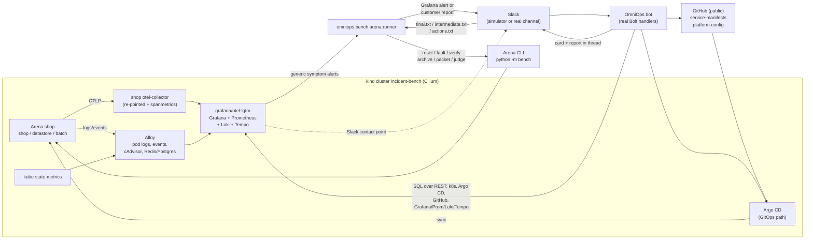

# OmniOps on the Edge Delta AI SRE Arena

The [Arena](../../vendor/project-arena/README.md) deploys a disposable Kubernetes shop, injects one of
21 faults, and scores the investigation a product delivered with an AI judge and a fixed rubric. This
adapter runs it on a local kind cluster and investigates every scenario the way OmniOps runs in
production: **the incident enters through Slack** (a Grafana Alerting notification, or a customer
report when nothing alerted), OmniOps queries Kubernetes, Argo CD, GitHub and the Grafana stack
**over SQL against their REST APIs**, and the answer it posts in the Slack thread is archived
verbatim and judged.

> **Scores from this adapter are non-official.** The judge is Meta `muse-wonder-1.0` through the
> Arena's `openai-compatible` provider, not the GPT-6-Astra judge behind the published Arena results,
> and it is the same model family as the investigating agent. Compare runs with each other, not with
> the leaderboard. Every run says so in `omniops-arena.json`, its product label and its console output.

## Architecture



Per scenario the runner executes, in order (`--dry-run` prints the exact commands):

1. **baseline** - `bench reset --confirm-disposable` (GitOps: `bench.gitops reset` + commit + `sync`), then
   wait until no `omniops=arena` alert is firing.
2. **probe** - read-only GETs of the storefront from inside the cluster (healthy baseline). The full
   suite runs them in the frontend pod; the smoke suite, whose only workload is the faulted API, runs
   them from a short-lived client pod (`kubectl run --rm`, the fixture's own image, namespace `default`)
   so a crashlooping, unpullable or Pending API is measured as unreachable instead of not measured.
3. **fault** - `bench fault --scenario S` (GitOps: `bench.gitops fault` + commit + `sync`).
4. **verify** - `bench verify` must observe the fault; otherwise the case is invalid and stops.
5. **detect** - poll Grafana's Alertmanager API (plus the webhook bridge) for alerts that started after
   the fault, up to 7 minutes. No alert: probe again and build a customer report from what got worse.
6. **launch** - post the launch message into Slack. An alert is an integration's post and OmniOps
   investigates it on its own. A customer report is a person's post: OmniOps triages it itself; if it
   has not replied in the thread within `--mention-grace` (90 s; the simulator knows when triage
   finished), an on-call user mentions the bot in the thread (`@OmniOps investigate`), exactly as in
   production. Never both, so one report never starts two runs (`progress.json` records which).
7. **investigate** - wait (investigation + report + watchdog budgets) for the bot's thread answer;
   every version of every message is captured.
8. **records** - `final.txt`, `intermediate.txt`, `actions.txt`, `transcript.json`, `run_results.json`.
9. **archive** - `bench archive --detection not_measured`, validated: archive-v1, `final_answer` equal to `final.txt`.
10. **packet**, 11. **judge** (Muse, non-official), 12. **reset**.

## Resource needs

| | |
|---|---|
| Host | Intel Mac (x86_64): the full suite's prebuilt shop images are linux/amd64 only |
| Docker memory | **10 GB** recommended (8 GB works but pods may be evicted for unrelated reasons); 4+ CPUs |
| Disk | ~25 GB (kind node images, 12 fault images, shop images, observability) |
| Time | first `up.sh`: 30-45 min (image builds); one scenario: 15-40 min |
| Tools | kind v0.33, kubectl v1.37, helm v4.3, gh, git, Python 3.10+ (all in `~/.local/bin`) |

## Before you start (things only you can do)

1. **Upgrade Docker Desktop** to the current release (Docker Desktop 4.11 / Engine 20.10 does not start
   or is too old for kind v0.33 + Cilium). Settings > Resources: Memory **10 GB**, CPUs 4+.
   `deploy/arena/up.sh --check` verifies all prerequisites and tells you what is missing.
2. **GitHub** (GitOps path only): `gh auth login`. You will create two **public** repositories,
   `service-manifests` and `platform-config`, by running commands the scripts print for you.
3. **Model API key**: `export MODEL_API_KEY=...` (OmniOps and the judge). Never put it in a file in the repo.
4. **Slack** (real-channel runs only; simulator runs need nothing):
   - the OmniOps app (Socket Mode): `SLACK_BOT_TOKEN`, `SLACK_APP_TOKEN`, invited to the alert channel;
   - a channel id: `OMNIOPS_ARENA_CHANNEL=C...`;
   - for Grafana's own notifications, an incoming webhook of a separate "Grafana" app
     (`SLACK_WEBHOOK_URL`), or that app's bot token + channel (`GRAFANA_SLACK_TOKEN`, `GRAFANA_SLACK_CHANNEL`).
     Never OmniOps' own token: the bot ignores its own posts;
   - a person's user token for customer reports and the "investigate" mention:
     `OMNIOPS_ARENA_POSTER_TOKEN=xoxp-...` (scope `chat:write`);
   - optional: `OMNIOPS_ARENA_ALERT_TOKEN` (a second app's bot token with `chat:write.customize`) to post
     Grafana-shaped alerts when Grafana's own post is not used.

## Bring up the cluster

Run from the OmniOps project root. Every script is idempotent; rerun after a failure.

```sh
export PATH="$HOME/.local/bin:$PATH"
deploy/arena/up.sh --check                 # prerequisites only
# optional, before up.sh, to have Grafana post to Slack:
export SLACK_WEBHOOK_URL=...               # or GRAFANA_SLACK_TOKEN=... GRAFANA_SLACK_CHANNEL=C...
```

### Direct deployment (kubectl applies faults)

```sh
deploy/arena/up.sh                         # kind + Cilium + images + observability + bench deploy
deploy/arena/up.sh --with-argocd           # same, plus Argo CD so OmniOps can query it (empty)
```

### GitOps deployment (faults are Git commits Argo CD applies)

```sh
deploy/arena/up.sh --gitops                # kind + Cilium + images + observability + Argo CD, no shop yet
deploy/arena/gitops.sh prepare             # clones/inits .state/gitops/*, runs 'bench.gitops export',
                                           # then STOPS and prints the commands below for you
gh repo create <you>/service-manifests --public --description "Arena GitOps repository for OmniOps"
gh repo create <you>/platform-config   --public --description "Arena GitOps repository for OmniOps"
git -C deploy/arena/.state/gitops/service-manifests add -A
git -C deploy/arena/.state/gitops/service-manifests commit -m 'Add benchmark application'
git -C deploy/arena/.state/gitops/service-manifests push -u origin main
git -C deploy/arena/.state/gitops/platform-config add -A
git -C deploy/arena/.state/gitops/platform-config commit -m 'Add benchmark fault definitions'
git -C deploy/arena/.state/gitops/platform-config push -u origin main
deploy/arena/gitops.sh bootstrap           # checks both are pushed, bench.gitops bootstrap + sync
```

OmniOps is configured with `service-manifests` only (`GITHUB_REPOS`). `OMNIOPS_ARENA_FAULT_REPO_ACCESS=1`
(before `omniops-env.sh`) also lists `platform-config`: it changes the evidence available (the fault
commit), so the runner records the choice in every run (`omniops-arena.json` > `access`). Both
repositories are public and Argo CD shows the revisions it applied from each, so this is a
configuration choice, not an access control; the access record says so.

### What gets installed

| Component | Namespace | Notes |
|---|---|---|
| `grafana/otel-lgtm:0.36.0` | observability | Grafana 13.2.3, Prometheus 3.15, Loki 3.7, Tempo 3.1, OTLP; one pod, 10 Gi PVC |
| kube-state-metrics v2.20.0 | observability | no Secret/ConfigMap metrics |
| Alloy v1.20.1 | observability | cAdvisor via the API server, Redis + PostgreSQL exporters, pod logs (Kubernetes API), events |
| Argo CD chart 10.4.0 | argocd | dex/notifications off; account `omniops` with `role:readonly`, minus the Arena's `arena-control` application (deny rule) |
| OmniOps' Kubernetes view | observability (ServiceAccount) + localhost | read-only ServiceAccount `omniops-arena` (`deploy/arena/kubernetes/omniops-reader.yaml`: get/list, no exec/proxy) behind `helper.py kube-proxy` on `localhost:8001`, which hides namespace `benchmark-control` |
| shop collector change | telemetry | `deploy/arena/observability/collector.yaml`: debug exporter -> LGTM, plus spanmetrics |

Grafana provisioning (`deploy/arena/observability/grafana/`): datasources with uids `prometheus`,
`loki`, `tempo`; an overview dashboard (uid `omniops-arena`, one panel per rule, same expressions) that
every rule links to, so notifications carry Grafana's Dashboard/Panel links (`from` = alert start - 1 h:
the alert parser recovers the exact onset from them); 14 **generic symptom rules** in folder "Platform alerts" (service error ratio, p95
latency, request-rate surge, restarts increasing, containers waiting in CrashLoopBackOff /
ImagePullBackOff / CreateContainerConfigError, OOMKilled, Pending > 2 min, unavailable replicas, Redis
memory / evictions / OOM rejections, Postgres lock waits / long transactions, error-log burst). They
name symptoms, never causes, and encode no answer key (a test checks this). Contact points: a webhook
to the runner's local bridge, plus Slack when configured; one notification groups the whole folder.

The PostgreSQL exporter is enabled only after its credential is verified once: a wrong password would
write authentication failures into the Postgres log, which the Arena's baseline check treats as
residual fault state.

### Connect OmniOps

`up.sh` / `gitops.sh bootstrap` start port-forwards and write `deploy/arena/.state/omniops.env`
(mode 600; printed with secrets masked):

```sh
deploy/arena/port-forward.sh start|stop|status   # Grafana :3000 Prometheus :9090 Loki :3100 Tempo :3200 Argo CD :8080
                                                  # + OmniOps' Kubernetes view :8001 (read-only proxy)
deploy/arena/omniops-env.sh                       # regenerate the env file
export GITHUB_TOKEN=github_pat_...               # read-only fine-grained PAT (Contents + Metadata: read) for
                                                  # the two repos; never written to the env file. `gh auth token`
                                                  # also works but carries your write scopes.
set -a; source deploy/arena/.state/omniops.env; set +a
uv run --no-sync omniops selftest                 # boot smoke queries per source
```

It sets `KUBECONFIG` (`.state/omniops-kubeconfig` first, your own kubeconfig second so `kubectl
--context kind-incident-bench` still works in that shell; OmniOps reads only the first entry) +
`KUBE_CONTEXT=omniops-arena` + `K8S_API_URL=http://127.0.0.1:8001`, `ARGOCD_URL`/`ARGOCD_TOKEN` (read-only),
`GITHUB_OWNER`/`GITHUB_REPOS`, `GRAFANA_URL`/`GRAFANA_TOKEN` (Viewer service account), the datasource
uids, `PROMETHEUS_URL`, `LOKI_URL`, `TEMPO_URL`, `ALERTMANAGER_URL`/`ALERTMANAGER_TOKEN`. Grafana's admin
password is in `deploy/arena/.state/grafana-admin-password` (user `admin`). Check the telemetry with
`deploy/arena/observability.sh selftest`: it queries for every series, stream, trace and rule the
alert rules depend on and fails loudly when one is missing.

**OmniOps never gets the kind admin kubeconfig.** The Arena records the active scenario id in ConfigMap
`benchmark-control/suite-state` (`data.scenario`, written at fault time); with a cluster-wide identity
it would show up in OmniOps' `kubernetes_configmaps` table and change feed, close to the answer, and
the judge would credit an answer that came from the harness. Kubernetes RBAC cannot carve one namespace
out of the cluster-wide lists the change feed uses, so OmniOps' kubeconfig carries no credential and
points at `helper.py kube-proxy` (started by `port-forward.sh`): it holds the read-only ServiceAccount
token, forwards GETs only, refuses every path under `namespaces/benchmark-control` (and exec, attach,
port-forward, proxy, watch) and drops `benchmark-control` objects from every list. Argo CD's `omniops`
account is denied the `arena-control` application (which syncs the same ConfigMap in GitOps mode).
Before the first case the runner lists ConfigMaps exactly as OmniOps would (its kubeconfig, context
and `K8S_API_URL`, always taken from the env file over the shell) and refuses to run if
`benchmark-control` is visible; the result and the hidden scope are in `omniops-arena.json` > `access`.

## Run the benchmark

```sh
export PATH="$HOME/Library/Python/3.9/bin:$HOME/.local/bin:$PATH" UV_PROJECT_ENVIRONMENT=venv
export MODEL_API_KEY=...

# the plan, without touching the cluster, Slack or any API
uv run --no-sync python -m omniops.bench.arena.runner --dry-run --suite full --scenarios oom,crashloop

# one scenario, Slack simulator (the real Bolt handlers in-process)
uv run --no-sync python -m omniops.bench.arena.runner --suite full --scenarios oom

# the whole full suite (21 scenarios), resumable: rerun with the same --run-id after an interruption
uv run --no-sync python -m omniops.bench.arena.runner --suite full --run-id full-1

# GitOps faults: the runner prepares each fault commit and PAUSES for you to push it
uv run --no-sync python -m omniops.bench.arena.runner --suite full --gitops --scenarios oom
#   (--allow-push lets it commit and push the fault repository itself)

# real Slack: start the bot in another terminal first
set -a; source deploy/arena/.state/omniops.env; set +a; uv run --no-sync omniops serve
uv run --no-sync python -m omniops.bench.arena.runner --suite full --real-slack --scenarios oom

# smoke suite (separate app: 'python3 -m bench cluster create' + 'bench deploy' with suite smoke)
uv run --no-sync python -m omniops.bench.arena.runner --suite smoke --scenarios crashloop
```

Useful flags: `--no-judge`, `--judge-model`, `--alert-wait 420`, `--alert-settle 45`, `--mention-grace 90`,
`--investigation-timeout`, `--bridge-port 8787` (0 disables the webhook bridge; polling still works),
`--arena-dir`, `--output-root`, `--context`, `--python`.

Outputs, one directory per attempt (`runs/arena/<run_id>/<scenario>-a<N>/`):

| File | Contents |
|---|---|
| `launch.json` | the launch message, its path (`alert` or `customer_report`), included/excluded alerts, symptoms, leak check |
| `probe-baseline.json`, `probe-fault.json` | storefront probes before/after the fault |
| `transcript.json` | every version of every message in the launch thread |
| `final.txt` | the verbatim final answer: final card + report pages as displayed |
| `intermediate.txt` | the live status trail and superseded versions (early card), timestamped |
| `actions.txt` | every tool call: full SQL, arguments, head+tail result digest, staged writes |
| `archive.json`, `packet.json`, `judgment.json`, `judge-attempts/` | the Arena's own files |
| `operations/`, `runner.log` | Arena operation receipts and every command the runner ran |

`runs/arena/<run_id>/` also holds `arena.json` (the Arena run config), `omniops-arena.json` (settings,
access record, judge notice), `progress.json` (resume state and every recorded problem) and
`summary.csv` (`bench report --summary`).

## How the launch message is chosen (and why it cannot leak the answer)

- **Alert path**: firing `omniops=arena` alerts whose `startsAt` is after the fault (minus 60 s skew;
  older alerts and `DatasourceError`/`DatasourceNoData` are excluded and recorded) are rendered exactly
  like Grafana's Slack contact point (`[FIRING:n] Platform alerts ...`, Grafana's default message
  template). With real Slack and a Slack contact point, Grafana's own post is used.
- **Customer report path**: nothing alerted, so support writes what customers experience, built only
  from the probes that got worse ("the storefront home page: it returns an error (HTTP 500)"); if
  nothing user-visible changed, the report is deliberately vague.
- The launch module never reads answer keys or fault manifests (a test runs it with file reads
  disabled). As defence in depth, the runner loads judge-only truth separately and refuses to post a
  message that contains an answer-key sentence or a scenario id; customer reports must also contain no
  answer-key identifier. Alerts legitimately carry workload labels (pod and container names) and
  generic words such as "OOM", so for them only hyphenated scenario ids count.

## How scoring works

`bench packet` combines the archive (`final_answer`, `intermediate`, `actions`), the scenario's answer
key and the frozen rubric (`docs/scoring-rubric-v1.0.0.md` in the Arena) into a judge-only packet.
`bench judge` sends it to the configured judge, keeps every attempt in `judge-attempts/`, and validates
the response (exact-substring citations, identity hashes). Seven dimensions: `rca`, `blast_radius`,
`final_quality` (supported mitigation), `implementation_readiness`, `action_safety`,
`intermediate_advice`, `causal_change`. Detection is `not_measured` (OmniOps is launched by the
harness, like the Arena's Claude columns). `bench report --summary` gives successful/applicable per
metric; `--details` per scenario.

Judge settings written into every run's `arena.json`:

```json
"judge": {"provider": "openai-compatible", "base_url": "https://api.meta.ai/v1",
          "api_key_env": "MODEL_API_KEY", "model": "muse-wonder-1.0",
          "max_output_tokens": 16384, "timeout": 900}
```

## Caveats

- **Non-official judge** (see the top), same model family as the agent: expect self-preference bias.
- Detection is not measured; the alert vs customer-report split depends on the generic rules and on
  laptop timing (a slow node can delay `for:` windows past the 7-minute wait).
- Customer reports only see read-only storefront GETs; checkout (a POST) is not probed, so a fault
  visible only at checkout produces the vague report unless an alert fires.
- The shop's collector was re-pointed at the LGTM stack (its exporter was a debug placeholder); in
  GitOps mode that change is part of the application repository.
- Real-Slack capture polls `conversations.replies`; edits between polls can be missed
  (`capture=polling` in `transcript.json`). The simulator records every edit.
- Real-Slack runs read the tool activity for `actions.txt` from the bot's case files
  (`OMNIOPS_CASE_DIR`, run results whose alert `source_ts` is the launch thread); when the bot runs on
  another disk there is no action trace, the case says so, and the judge must answer
  `insufficient_evidence` for action safety.
- With Grafana's own Slack contact point configured, an alert that fires only after the runner gave up
  waiting (and posted a customer report) is posted by Grafana too and starts a second run in another
  thread; only the launch thread is archived.
- Single attempts are not averages: LLM-chosen queries differ per run.

## Tear down

```sh
deploy/arena/down.sh --yes            # stops port-forwards, deletes the kind cluster and its credentials
deploy/arena/down.sh --yes --purge    # also deletes deploy/arena/.state (local GitOps checkouts)
# the GitHub repositories are yours to delete:  gh repo delete <you>/service-manifests
```

## Tests (offline)

```sh
uv run --no-sync pytest tests/test_bench_arena* -q
```

- `test_bench_arena_launch.py`: customer reports for every symptom combination contain none of the 21
  answer keys (cause sentences, identifiers, scenario ids); the builder reads no files; the Grafana-shaped
  message parses with `agent.alert.parse_slack_alert` (onset recovered from the dashboard link); alert
  rules and the dashboard encode no answer key.
- `test_bench_arena_records.py`: final = latest run's card + report as displayed; intermediate = status
  trail, superseded versions and other posts; actions = every tool call; archive-v1 validation.
- `test_bench_arena_runner.py`: `--dry-run` prints the command sequence with no subprocess; one full case
  offline against a fake Arena CLI (records, archive, judgment, resume); unobserved faults stop before
  Slack; GitOps pushes need `--allow-push` or an operator (printed commands survive paths with spaces);
  triage-vs-mention; the Alertmanager poll and the webhook bridge; the pre-flight refuses a run whose
  Kubernetes identity can read `benchmark-control`; the smoke probe measures an API that is down.
- `test_bench_arena_deploy.py`: every script parses; `up.sh --check` stops on Docker Desktop 4.11-era
  engines and on ARM, and recommends 10 GB; the notification Secret; run configurations; `kube-proxy`
  hides the suite state from lists and paths and is GET-only; `omniops-env.sh` gives OmniOps the
  credential-less view, never the admin kubeconfig; the Argo CD deny rule; `up.sh` rebuilds when any
  fault image is missing.

## Troubleshooting

- `up.sh --check` fails on Docker: upgrade Docker Desktop and raise its memory, restart it.
- `bench verify` did not observe the fault: the case stops (an unobserved fault is not a valid test);
  see `operations/*/evidence.json`. `netpol-isolation` needs Cilium (installed by `up.sh`).
- No alerts ever fire: `deploy/arena/observability.sh selftest`; the webhook bridge is optional
  (Grafana reaches it at `host.docker.internal:8787`).
- A run stopped half-way: rerun with the same `--run-id`; finished scenarios are skipped, a case with
  records resumes at archive, anything earlier starts a fresh attempt from the baseline reset.
- The runner refuses with "OmniOps' Kubernetes identity can read namespace benchmark-control": the env
  file predates the read-only view (it still names the admin kubeconfig). It warns instead that the view
  "could not be listed" when the proxy is not running (port-forwards started before it existed). Either
  way: `deploy/arena/port-forward.sh stop`, `deploy/arena/port-forward.sh start`, `deploy/arena/omniops-env.sh`.
